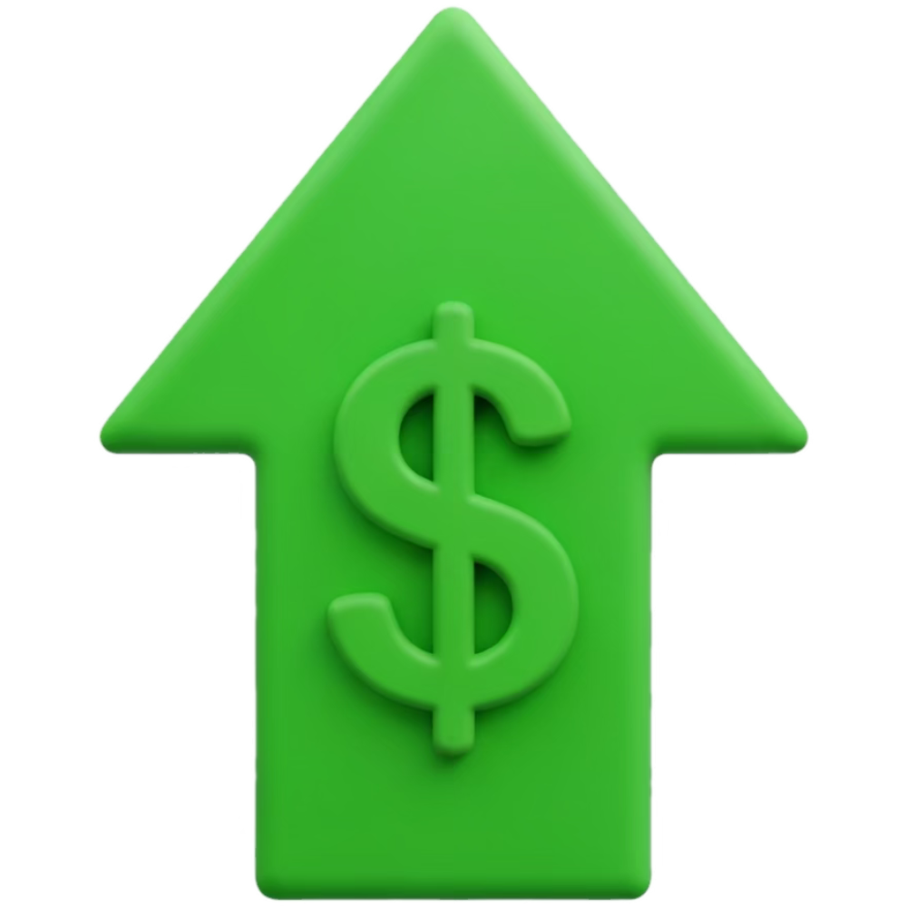

# Market trade

Start with $100. Trade your way to $450 before the market closes.

## Overview

Market trade is a single-player Python trading game. You start with an empty inventory and $100 in cash. Buy and sell SOL, BTC, gold, EUR, and ETH as prices change from day to day. To win, finish with at least $450 in cash and assets combined.

## Features

- Five tradable assets with independently changing daily prices.
- Single-unit and bulk trades, with purchases limited by your cash and sales limited by your inventory.
- A desktop interface with market prices, daily price changes, portfolio totals, and a price-history chart.
- A terminal version with commands for trading, checking prices, and viewing your inventory.

## Installation

Use Python 3.12 or later. The desktop version also needs Tkinter. Run `python3 -m tkinter` to check that your Python installation can open a Tk window.

From a macOS or Linux shell, clone the repository and activate a virtual environment.

```sh
git clone https://github.com/rapphcd/market-trade.git
cd market-trade
python3 -m venv .venv
source .venv/bin/activate
```

To launch the desktop version, install its dependencies and run the main script.

```sh
python -m pip install customtkinter matplotlib
python main.py
```

To play in the terminal, run this from the project root.

```sh
python terminal/main.py
```

## How to play?

- Check the current prices before you trade. Every asset starts at $30 before the first market update. Each day, its price moves by a random amount between −$10 and +$10 and stays at or above $1.
- Buy or sell as many times as your cash and inventory allow during the current day. Advance when you are ready to see the next set of prices.
- Track your **Wallet** for available cash and your **Total** for cash plus the current value of your holdings. Any assets you still hold at the end count toward your $450 goal.

### Desktop

| Control | Action |
| --- | --- |
| **Buy 1** | Buy one unit at the current price. |
| **Buy all** | Buy as many whole units of that asset as your wallet can afford. |
| **Sell 1** | Sell one unit at the current price. |
| **Sell all** | Sell every unit you hold of that asset. |
| **Next day** | Refresh prices and update the chart and portfolio value. |

You can trade on days 1 through 15. On day 15, clicking **Next day** updates prices one last time and shows your result using day 16 prices.

### Terminal

The prompt already displays `/`. Type the commands below directly after it and press Enter. Use the asset codes `sol`, `btc`, `gold`, `eur`, and `eth`.

| Command | Action |
| --- | --- |
| `buy btc 2` | Buy two units of BTC. |
| `buy btc max` | Buy as many units of BTC as you can afford. |
| `sell btc 1` | Sell one unit of BTC. |
| `sell btc all` | Sell every BTC unit in your inventory. |
| `market` | Show current prices and their changes. |
| `inv` | Show your cash, holdings, and total portfolio value. |
| `next` | End the current day. |

Both `max` and `all` work with either trade command. On day 15, enter `next` to see your result using that day's prices.

## Settings

Edit `config.py` to change the desktop asset list or chart colors. Each asset listed in `RESOURCES` needs a matching entry in `RESOURCES_COLORS`. The terminal version defines its asset list in `terminal/classes.py`.

## Tech Stack

- **Python** for the game rules, price simulation, and terminal interface.
- **CustomTkinter** for the desktop interface.
- **Matplotlib** for the desktop price chart.

| File | Purpose |
| --- | --- |
| `main.py` | Launches the desktop game. |
| `game.py` | Advances the market, records price history, and determines the result. |
| `market.py` and `resource.py` | Store tradable assets and update their prices. |
| `player.py` | Manages cash, holdings, and transactions. |
| `interface.py` | Builds the desktop controls, market view, inventory, and chart. |
| `config.py` | Defines the desktop asset list and chart colors. |
| `terminal/main.py` | Runs the terminal game loop and reads commands. |
| `terminal/commands.py` | Handles terminal trading and display commands. |
| `terminal/classes.py` | Holds the terminal version's game, market, and player logic. |

## Dependencies

| Dependency | Used by |
| --- | --- |
| Python 3.12+ | Both versions |
| Tkinter | Desktop |
| CustomTkinter 6.0.0 | Desktop |
| Matplotlib 3.11.2 | Desktop |

The table lists the versions installed in my development environment. The terminal version only uses the Python standard library.

---

[@rapphcd](https://github.com/rapphcd)